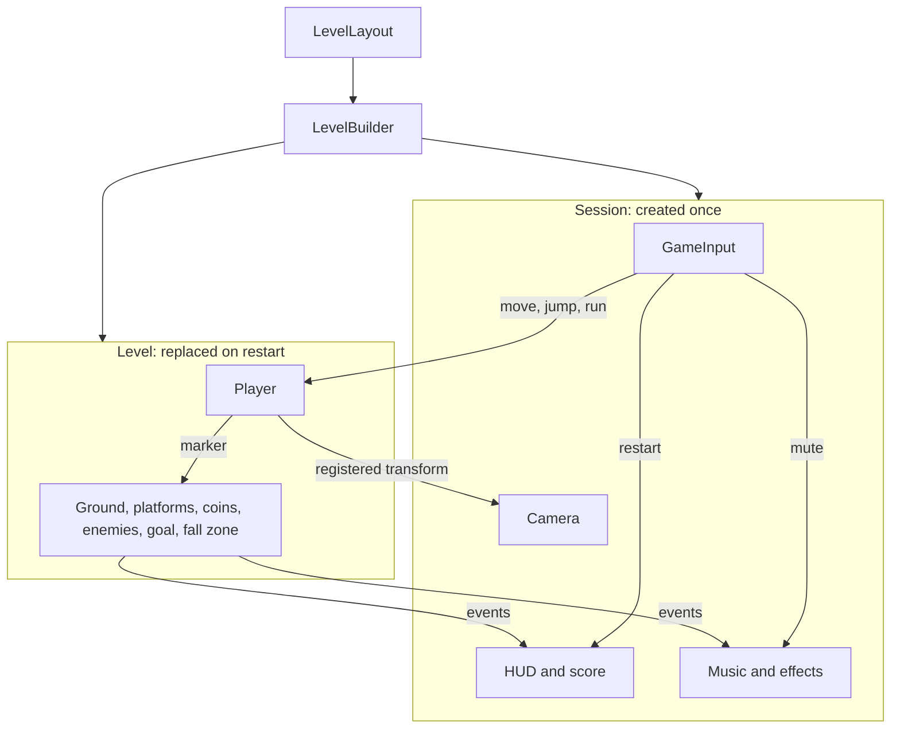

# How the code is put together

Pixel Adventure is built in C#. Scripts create the player, the level, the camera, and the HUD. The `Main` scene stays empty.

These articles each explain one idea. Read them in order the first time. After that, open only the one you need.

| Article | What it answers |
| --- | --- |
| [Parts](parts.md) | What a part is, and why some objects survive a restart |
| [Data](data.md) | Where positions, tuning, and draw order live |
| [Messages](messages.md) | How a coin, an enemy, and a key press reach the HUD without holding references to it |
| [A round](a-round.md) | What happens from pressing Play to pressing R |

The session group stays up for the whole play session. The level group is thrown away and built again when the level restarts. `LevelBuilder` is the only thing that decides which layout to build.
