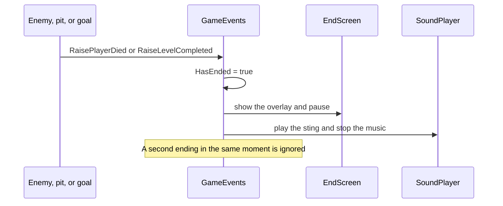
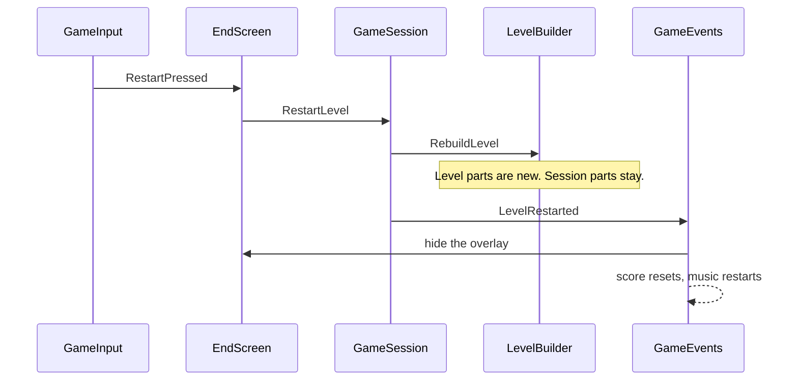

# A round

A round is one try at the current level: from the moment play starts until the player dies or reaches the flag, and then the restart.

## Start

`GameBootstrap` runs after the first scene loads and calls `LevelBuilder.Rebuild`. That builds the session and `LevelLayout.Level1`.

The HUD shows score 0. `SoundPlayer` starts the music. The camera snaps to the player.

## Play

The player moves. Coins raise `CoinCollected`. `ScoreCounter` adds the value and tells `ScoreDisplay` to refresh. `SoundPlayer` plays the coin sound. Nothing in that chain holds a reference to the others.

## End

Touching an enemy or falling into the pit raises `PlayerDied`. Touching the flag raises `LevelCompleted`. Whichever happens first sets `GameEvents.HasEnded`.

`EndScreen` pauses the game with `Time.timeScale = 0` and shows **Game Over** or **Level Complete!**, the score, and the coins collected. `SoundPlayer` stops the music and plays the matching sting.

## Restart

R, gamepad Start or South, or a tap raises `GameInput.RestartPressed`. For the first half second the end screen ignores it.

`GameSession.RestartLevel` then does three things, in order:

1. Set `Time.timeScale` back to 1.
2. `LevelBuilder.RebuildLevel`, which destroys and recreates the level content and points the camera at the new player.
3. `GameEvents.RaiseLevelRestarted`.

The listeners reset themselves. The score goes back to 0. The overlay hides. The music starts again. The camera, the HUD object, and the sound player were never destroyed.

**Rebuild All** is different. It destroys the session too, then builds everything from scratch. That is what Play mode and the editor preview use. Restart during play does not do that.
