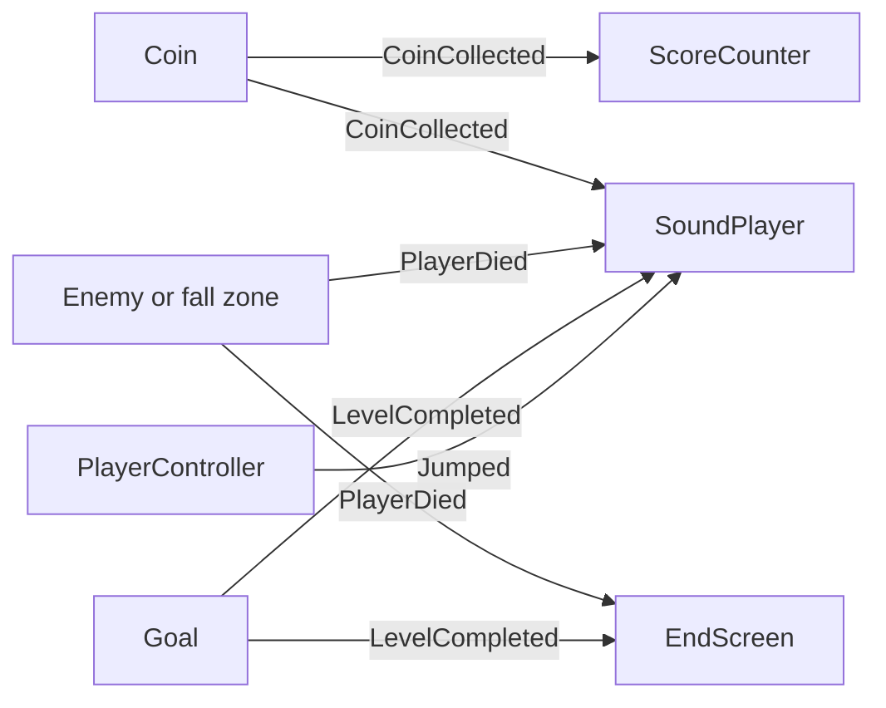

# Messages

A coin should not know about the score. An enemy should not know about the game-over screen. The keyboard should not be read in three classes. Each of those is a message: something happens, and whoever cares is listening.

## GameEvents

`GameEvents` is the list of things that happen during play. The object that causes an event calls `Raise…`. The object that reacts subscribes in `OnEnable` and unsubscribes in `OnDisable`.

| Event | Who raises it | Who listens |
| --- | --- | --- |
| `Jumped` | `PlayerController` | `SoundPlayer` |
| `CoinCollected(value)` | `Coin` | `ScoreCounter`, `SoundPlayer` |
| `PlayerDied` | an enemy, or the fall zone | `EndScreen`, `SoundPlayer` |
| `LevelCompleted` | the goal | `EndScreen`, `SoundPlayer` |
| `LevelRestarted` | `GameSession` | `ScoreCounter`, `EndScreen`, `SoundPlayer` |

`HasEnded` records that the round is over. The first of `PlayerDied` and `LevelCompleted` wins. The other raise does nothing, so the overlay and the music always follow the same outcome. Jumps and coins are ignored after that, so a late touch cannot add points.

`BeginRound` clears that flag. A full rebuild and a level rebuild both call it.

## PlayerMarker

"Is this the player?" is not the same question as "how does the player move?"

`PlayerMarker` is an empty component on the player object. Coins, the goal, the fall zone, and enemies look for that component. `PlayerController` only walks, runs, and jumps. `PlayerAnimator` is the one script that still reads the controller, because it needs to know if the player is on the ground and which way they face.

While the player part is created, it stores the player's transform on `context.Player`. The camera follows that transform. After a restart the player is a new object, and the camera is pointed at the new one.

## GameInput

Move, jump, run, mute, and restart are created once, on the session `GameInput` object. Rebuilding the level does not recreate the bindings.

| Action | Control |
| --- | --- |
| Move | A and D, arrow keys, left stick |
| Jump | W, Up, Space, gamepad South |
| Run | Left Shift, gamepad West |
| Mute | M, gamepad Select |
| Restart | R, gamepad Start or South, click or tap |

`PlayerController` reads Move, Jump, and Run from `GameInput.Instance`. Mute and restart are events. `SoundPlayer` toggles mute. `EndScreen` restarts only when the round has already ended, and only after a short delay, so the jump that caused the death does not immediately start a new game.

A new control is a binding in `GameInput`. Gameplay code does not read the keyboard or the gamepad itself.
