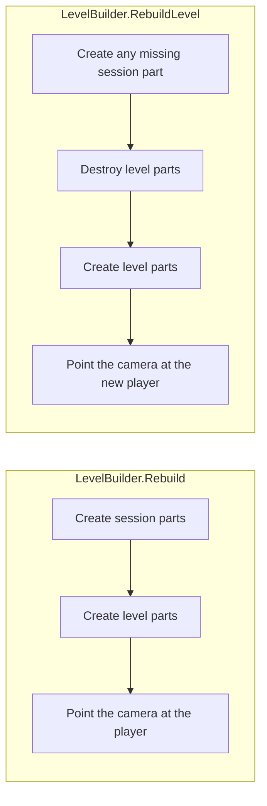

# Parts

A **part** is one piece of the game that code can create and destroy on its own. The camera is a part. The coins are a part. The player is a part.

Every part is a class that implements `ILevelPart` in `Assets/Scripts/Level/`. It has an id, such as `"Player"` or `"Coins"`, and a `Create` method. `Create` must put everything it makes under the parent it is given.

`LevelBuilder` puts each part in its own object:

```text
[Generated]
  Input
  Lighting
  Camera
  HUD
  Audio
  Ground
  Platforms
  FallZone
  Coins
  Enemies
  Goal
  Player
```

Clearing a part destroys that object. The part does not delete its own objects, so a rebuild cannot leave a duplicate behind. Nothing outside `[Generated]` is touched.

## Two lists

Some parts are the **session**. They are created when the game starts and stay up.

| Part | What it makes |
| --- | --- |
| Input | `GameInput`, the shared controls |
| Lighting | the global 2D light |
| Camera | the camera that follows the player |
| HUD | the score and the end screen |
| Audio | music and sound effects |

The rest are the **level**. `RebuildLevel` destroys them and creates them again. The session objects stay.

| Part | What it makes |
| --- | --- |
| Ground | floor segments |
| Platforms | one-way planks |
| FallZone | the pit under the level |
| Coins | collectible coins |
| Enemies | patrolling enemies |
| Goal | the finish flag |
| Player | the player |



`Rebuild` is the full build. Play mode and **Rebuild All** use it. `RebuildLevel` is the restart. It keeps the camera, the HUD, and the music player.

`Rebuild("Ground")` replaces only that one part. `Clear` removes everything under `[Generated]`.

The lists are the two arrays at the top of `LevelBuilder`. That file is the only place that chooses the order. A later part may look up an earlier one. The player is created before the camera is pointed at them, because `BindSession` runs after both lists.

## LevelContext

`Create` receives a `LevelContext`. The context has three things:

- `Root`, the `[Generated]` object
- `Layout`, the current level's positions
- `Player`, the transform the player part registers while it is created

`context.Find<T>("Coins")` searches that part's objects in the scene. It does not remember an old reference, so the result is still valid after a single part is rebuilt.

A camera-only rebuild does not run the player part, so `context.Player` is empty. The camera then looks in the scene for a `PlayerMarker`.

## Adding a part

1. Create a class in `Assets/Scripts/Level/Parts/` that implements `ILevelPart`.
2. Give it a unique id.
3. Add it to the session list or the level list in `LevelBuilder`.

If the object should survive a restart, it belongs in the session list. If it belongs to one level, it belongs in the level list.

## In the editor

`GameBootstrap` calls `Rebuild` when a build starts, because `Main` is empty.

In the Editor, Play mode builds the level when **Build level when entering Play mode** is on, or when a preview is already in the scene. Entering Play mode drops generated sprites, so a preview has to be built again to be visible.

**Tools → Pixel Adventure → Level Builder Window** has **Rebuild All**, **Rebuild Level**, and **Clear All**, plus **Rebuild** and **Clear** for each part. If a preview is in the scene, it is rebuilt after scripts recompile. The preview is removed before the scene is saved, so it never ends up in the scene file.
